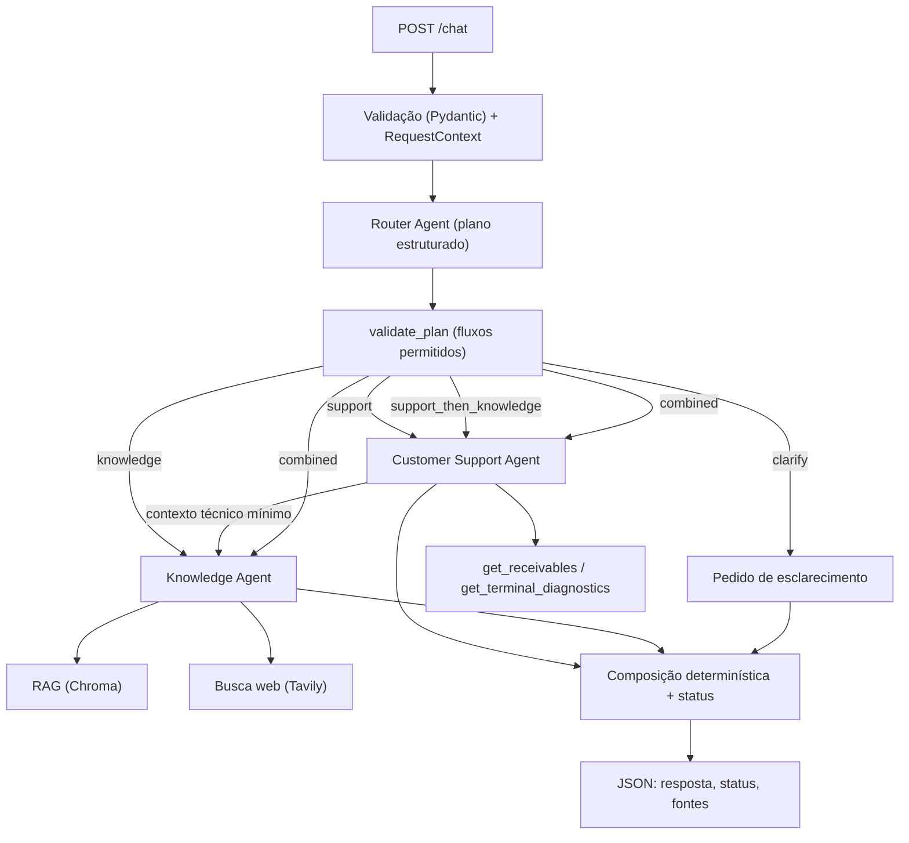

# Getnet Multi-Agent Support

Serviço HTTP em que **três agentes cooperam** para responder mensagens de clientes da Getnet:

| Agente | Papel |
|---|---|
| **Router** | Lê a mensagem e escolhe um fluxo permitido (`knowledge`, `support`, `support_then_knowledge`, `combined`, `clarify`). |
| **Knowledge** | Responde perguntas públicas com **RAG** sobre páginas oficiais da Getnet (Chroma) e **busca web** (Tavily) para perguntas gerais (clima, câmbio). |
| **Customer Support** | Consulta dados **individuais** do cliente com duas ferramentas: `get_receivables` e `get_terminal_diagnostics`. |

Ideia central: **o LLM interpreta e escolhe ferramentas; o código controla identidade, sequência de execução, evidências e limites.** Cada resposta carrega as fontes que a sustentam, e os valores financeiros vêm da ferramenta, não da geração.

> A especificação de comportamento (critérios de aceite, contratos, falhas) está em [`spec.md`](spec.md); o plano de implementação em `docs/superpowers/plans/`.

## Estado da verificação

| Verificado | Como |
|---|---|
| Lógica dos agentes, orquestração, API, identidade, falhas, RAG e ingestão | 182 testes (`pytest`), rodando também dentro do Docker; inclui o `chat.completions.parse` **real** do SDK da OpenAI (só a rede é simulada) com todas as ferramentas em modo estrito |
| Fluxo Docker ponta a ponta, com serviços reais | `docker compose build` → `run --rm api python -m app.ingest` (**25 páginas, 41 chunks, 0 falhas**) → `up`; `/health` com `index: ready`; perguntas de recebíveis, Pix e produto inexistente respondidas |
| Serviços reais (OpenAI `gpt-6-luna` com `OPENAI_REASONING_EFFORT=none`, embeddings, Tavily) | `pytest -m live`: **7/7** (cada pergunta de RAG recupera a página esperada; Tavily responde). `evals`: **14/15** contra a API do Docker (veja [Avaliação](#avaliação-de-ia)) |

Verificação feita em 10/11/2026. Os testes padrão não usam rede nem chaves; as verificações com serviços reais ficam marcadas `@pytest.mark.live`.

## Como executar

Pré-requisitos: Docker (ou Python 3.11), uma chave OpenAI e uma chave Tavily.

```bash
cp .env.example .env          # PowerShell: Copy-Item .env.example .env
                              # preencha OPENAI_API_KEY, TAVILY_API_KEY e OPENAI_CHAT_MODEL
docker compose build
docker compose run --rm api python -m app.ingest   # baixa as páginas oficiais e cria o índice (volume chroma_data)
docker compose up                                   # API em http://localhost:8000
```

Em seguida, abra `http://localhost:8000/docs` (Swagger) ou use os exemplos abaixo. Para parar: `Ctrl+C` (ou `docker compose down`; o índice permanece no volume).

**Porta 8000 ocupada?** A porta do host é configurável:
```bash
API_PORT=8011 docker compose up            # PowerShell: $env:API_PORT=8011; docker compose up
```

**Ingestão falha com `permission denied` ou o índice parece corrompido?** Provavelmente há um volume antigo de outra versão da imagem. Recrie-o: `docker compose down -v` e rode a ingestão de novo.

| Variável | Para quê |
|---|---|
| `OPENAI_API_KEY` | chat com tool calling e embeddings (obrigatória) |
| `OPENAI_CHAT_MODEL` | modelo de chat com tool calling e saída estruturada (obrigatória) |
| `OPENAI_REASONING_EFFORT` | opcional. Modelos de raciocínio (ex.: `gpt-6-luna`) só aceitam ferramentas no Chat Completions com `none`; deixe vazio para modelos que rejeitam o parâmetro (ex.: `gpt-4o`) |
| `OPENAI_EMBEDDING_MODEL` | padrão `text-embedding-3-small` |
| `TAVILY_API_KEY` | busca web; sem ela o Knowledge responde só com RAG e informa a lacuna em perguntas gerais |
| `CHROMA_PATH` | onde o índice é persistido (no Docker: `/data/chroma`, volume nomeado) |

A imagem da API roda como usuário sem privilégios e tem `HEALTHCHECK` em `/health`. A API recusa iniciar, com mensagem clara, se `OPENAI_API_KEY` ou `OPENAI_CHAT_MODEL` faltarem. Se o índice estiver ausente, `GET /health` mostra `"index": "missing"` e perguntas que exigem RAG devolvem 503 `index_unavailable`.

### Exemplo

```bash
curl -s localhost:8000/chat -H 'content-type: application/json' \
  -d '{"message": "When will the money from yesterday'\''s sales be deposited?", "user_id": "cliente1988"}'
```

```jsonc
{
  "request_id": "req_ab12cd34ef56",
  "status": "answered",            // answered | partial | needs_clarification | insufficient_evidence | handoff_recommended | customer_not_found
  "answer": "Recebíveis das vendas de 06/11/2026 (dados demonstrativos):\n- Venda R-1988-001: R$ 1.250,00, liquidação em 07/11/2026, status: previsto ...",
  "agents_used": ["router", "customer_support"],
  "sources": [{"id": "R-1988-001", "type": "customer_record", "title": "Recebível R-1988-001", "url": null}],
  "data_mode": "demo",             // "demo" quando dados sintéticos de cliente foram usados
  "workflow": "support",           // campos extras, úteis para depuração e avaliação
  "tools_used": ["get_receivables"]
}
```

Clientes sintéticos: `cliente1988` (recebíveis previstos + terminal offline com `ADQ 1-19` e última transação recusada), `cliente2000` (outros recebíveis + 2 terminais funcionando). Qualquer outro `user_id` válido → `customer_not_found` nas perguntas de dados individuais; perguntas públicas funcionam normalmente.

### Erros HTTP

| Código | Quando |
|---|---|
| 422 | payload inválido (mensagem vazia/gigante, `user_id` fora de `^[A-Za-z0-9_-]{1,64}$`) — o LLM nem é chamado |
| 503 `llm_unavailable` | provedor de LLM falhou de forma persistente (1 retry com pausa) ou devolveu saída fora do schema duas vezes |
| 503 `index_unavailable` | índice ausente/incompatível numa pergunta que exige RAG |
| 500 `internal_error` | erro inesperado (JSON, sem detalhes internos; o tipo do erro vai para o log) |
| 503 `budget_exceeded` | limite de chamadas (LLM/ferramentas) esgotado **sem nenhum resultado parcial** |
| 504 `deadline_exceeded` | prazo (40 s) esgotado **sem nenhum resultado parcial** — com resultado parcial a resposta é `partial` |

### Desenvolvimento local e testes

```bash
python -m venv .venv && .venv/Scripts/activate        # Linux/macOS: source .venv/bin/activate
pip install -r requirements-dev.txt
python -m ruff check . && python -m ruff format --check . && python -m mypy app && python -m pytest   # verificação única
python -m pytest -m live                              # verificações reais (exigem .env)
docker compose --profile test run --rm tests          # a mesma suíte, no Docker
```

## Arquitetura



### Fluxo de mensagens

1. `POST /chat` valida `message` e `user_id` e cria um `RequestContext` por requisição (identidade, relógio, orçamento, evidências). Não existe `current_user_id` global.
2. O **Router** faz uma chamada estruturada (sem ferramentas e sem a identidade do cliente). O **código** valida o plano: fluxo permitido, ordem e agentes corretos, no máximo 2 tarefas. Plano inválido → 1 nova tentativa → `clarify`.
3. O orquestrador executa o fluxo **em sequência**. Agentes não se chamam: o código passa objetos tipados.
   - `support_then_knowledge`: o Support consulta o diagnóstico; só `terminal_model`, `error_code` e `issue` seguem ao Knowledge (nunca ids, valores ou identidade).
   - `combined`: duas subperguntas independentes; cada ramo é isolado — se um falha, a parte válida sai com `status="partial"` e uma nota de pendência.
4. A composição é determinística (seções por especialista). O status final segue regras explícitas (`merge_status`).

### Como as ferramentas (tool calling) são usadas

- Cada agente roda um loop (`run_agent`): o LLM chama ferramentas até devolver uma **saída estruturada** (`AgentOutput`).
- Ferramentas são `ToolSpec` com `args_model` Pydantic **`extra="forbid"`**, enviadas ao OpenAI em modo **strict** (`pydantic_function_tool`): o LLM só escolhe o que a ferramenta declara, e campos opcionais vão como `null` explícito. A identidade do cliente **não é argumento** — vem de `ctx.user_id`. Um tool call com `user_id` extra é rejeitado antes de executar.
- Nome desconhecido, argumentos inválidos ou orçamento de ferramentas esgotado voltam ao LLM como resultado de erro, sem derrubar a requisição. Se as rodadas de ferramentas acabam, uma chamada final **sem ferramentas** força a resposta com o que já foi coletado.
- Toda ferramenta devolve `ToolResult` com `status`, dados tipados e **evidências** (`id`, `type`, `title`, `url`). O servidor registra as evidências da requisição; o LLM só **seleciona ids**, e URLs/títulos finais vêm dos metadados. Ids inventados são descartados.

### Pipeline de RAG

1. **Ingestão** (`python -m app.ingest`, comando separado da API): lê `data/sources.json` → baixa cada URL (timeout, falhas registradas) → extrai o conteúdo principal (trafilatura, sem menu/rodapé) → *chunking* (~700 tokens estimados, sobreposição de ~80, perguntas de FAQ ficam junto da resposta) → embeddings OpenAI → persiste no Chroma. Repetível: reingerir substitui os chunks da URL e **remove do índice as páginas retiradas de `sources.json`** (uma página que apenas falhou nesta rodada mantém os chunks antigos). Sem `OPENAI_API_KEY` sai com código 2 antes de baixar qualquer página. Trocar `OPENAI_EMBEDDING_MODEL` exige índice novo: `docker compose down -v` (apaga o volume) e ingerir de novo. Imprime resumo (páginas ok, falhas, chunks); sai com erro só se **nenhuma** página entrar.
2. **Armazenamento**: Chroma persistente (volume Docker). Cada chunk guarda `chunk_id`, `source_url`, `title`, `market`, `language`, `fetched_at`, `content_hash`. Um `manifest.json` registra modelo e dimensão dos embeddings; consultar com outro modelo é recusado (`incompatible`).
3. **Recuperação**: `retrieve_getnet_knowledge(query, market, topic)` → `top_k=5`, filtrando por mercado. A distância vetorial **não** é exposta como "confiança".
4. **Geração**: o Knowledge responde só com o que os trechos sustentam, preserva condições e limitações, cita ids de evidência e declara a lacuna quando não há suporte (`insufficient_evidence`). Conteúdo recuperado é tratado como **dado**, nunca como instrução.

**Fontes** (`data/sources.json`, 25 páginas): FAQ oficial, páginas de produto (Get Clássica, aluguel/planos, Get Smart, Get Lite), Pix, Get Conta, antecipação, erros de maquininha (ADQ 1-19), Wi-Fi, status de vendas, crediário, Link de Pagamento/WhatsApp e a página global sugerida no enunciado (`getnet.net/en`, mercado `global`). Todas foram sondadas com HTTP real e conteúdo extraído ≥ 500 caracteres.
Notas: o enunciado sugere o site global, mas os cenários são brasileiros, então o corpus é majoritariamente `site.getnet.com.br`. A página `/maquininha/get-smart/` é renderizada por JavaScript (quase sem texto extraível), então informações da Get Smart vêm de outras páginas (FAQ, soluções Get Smart, planos). Páginas coletadas numa data podem trazer ofertas antigas — por isso o prompt manda avisar que condições podem mudar.

## Decisões e trade-offs

- **Sem LangGraph**: fluxo pequeno e explícito em funções async é mais fácil de depurar e explicar; a arquitetura lógica valeria igual com um grafo.
- **Composição e status em código**: evita uma chamada extra de LLM. O bloco de recebíveis é um template com os dados da ferramenta, e o texto livre do LLM é trocado por uma nota fixa se afirmar pagamento/confirmação de um recebimento que a ferramenta não marca como `pago` (verificação por padrões, em PT e EN: é uma salvaguarda forte, não uma prova semântica).
- **Execução sequencial**: simples e previsível; paralelizar o `combined` é uma otimização futura.
- **Chroma local**: zero serviços extras para a demo; para múltiplas instâncias, trocar por um vetor store gerenciado (a interface `KnowledgeIndex` isola isso).
- **`user_id` não autentica**: no desafio ele só seleciona um cliente sintético. Em produção precisa vir de identidade autenticada/autorizada.
- **Sem memória entre requisições**: o payload do desafio não tem sessão; se o sistema pede esclarecimento, a próxima requisição precisa trazer contexto.
- **Estimativa de tokens (~4 caracteres/token)** no *chunking*, para não depender de baixar um tokenizador.
- Fixtures de clientes usam **offsets de data** para que "ontem" funcione em qualquer dia da demo.

## Guardrails e confiabilidade

- Validação de entrada antes de qualquer chamada ao LLM; identidade só no `RequestContext`; o repositório filtra por esse contexto e terminais de outro cliente nunca são revelados.
- Plano do Router validado pelo código; limites por requisição configuráveis (≤2 especialistas, ≤6 chamadas LLM incluindo retry, ≤4 ferramentas, ≤1 busca web, deadline 40 s).
- Evidências verificadas pelo servidor; sem evidência validada → `insufficient_evidence` **e o texto do LLM é descartado** (resposta fixa "não encontrei nas fontes"), para não vazar condição comercial vinda da memória do modelo.
- Falhas de um ramo viram `partial`. `handoff_recommended` é emitido quando há **problema técnico diagnosticado e nenhuma orientação oficial** (`support_then_knowledge`): é só uma recomendação, nunca um atendimento aberto. Terminal ambíguo vira `needs_clarification`.
- Busca web recebe só consulta pública (sem dados do cliente); logs não contêm mensagem, resposta nem `user_id`.

## Estratégia de testes

Pirâmide pensada para um sistema multiagente, onde o LLM é a parte não determinística:

1. **Integração da API até a resposta**, com um LLM *roteirizado* (`ScriptedLLM`) e fakes de embeddings/busca/relógio. Verifica contratos, roteamento, ferramentas, isolamento entre clientes, fluxo composto, falhas e limites **sem custo e sem flakiness**. Cada critério de aceite da spec tem um teste (`tests/test_api.py`, `tests/test_orchestrator.py`).
2. **Unidade das peças determinísticas**: chunking, índice, ferramentas, validação de plano, template de recebíveis, cliente OpenAI (com stub).
3. **Verificações reais separadas** (`-m live`, exigem `.env`): ingestão, embeddings, recuperação, Tavily.
4. **Avaliação de IA** (abaixo) para o que testes determinísticos não alcançam: qualidade de roteamento e de resposta com o modelo real.

Para ampliar a integração: gravar/reproduzir respostas reais do provedor (VCR) para regressão barata, e testes de carga para validar os limites de orçamento e deadline sob concorrência (já há um teste de concorrência com usuários distintos).

## Avaliação de IA

`evals/cases.json` traz **15 casos**: as 10 mensagens do enunciado + composta, terminal ambíguo, produto inexistente (sem evidência), cliente desconhecido e tentativa de troca de usuário. Cada caso define rota, ferramentas, fontes aceitáveis, valores que devem ser preservados e afirmações proibidas.

```bash
docker compose up -d
python -m evals.run_evals            # imprime PASS/FAIL por caso e as métricas
```

Métricas: acerto de rota, de ferramentas, de fontes esperadas, de status, preservação de valores e ausência de afirmações proibidas. A pontuação detecta regressões objetivas; a **qualidade semântica** das respostas continua exigindo revisão manual (evolução natural: LLM-as-judge com rubrica). 

**Resultado mais recente (10/11/2026, API no Docker, `gpt-6-luna`): 14/15 casos.**

| Métrica | Acertos |
|---|---|
| rota | 15/15 |
| ferramentas | 15/15 |
| fontes esperadas | 6/6 |
| status | 13/14 |
| preservação de valores | 15/15 |
| afirmações proibidas ausentes | 15/15 |

O caso que falha é o `x13` (produto inexistente, "Getnet Quantum 9000"): o texto diz corretamente que **não encontrou** a taxa, mas o status sai `answered` em vez de `insufficient_evidence`, porque o modelo cita trechos genéricos (que mencionam que as taxas variam) como evidência. É um limite conhecido: o status depende de o modelo não citar evidência quando conclui que não achou, e isso não é imposto em código. Nota: na primeira rodada o `e04` (Pix) também falhou, mas era uma lacuna do dataset — a resposta citava a FAQ oficial (`/duvidas/`), que faltava na lista de fontes esperadas; a lista foi corrigida depois de conferir a fonte citada.

## Observabilidade e monitoramento em produção

Implementado: logs JSON estruturados (ids de recebíveis e diagnósticos não são logados, pois embutem o número do cliente), uma linha por evento (`route`, `tool_call`, `agent_completed`, `agent_failed`, `request_completed`, `request_failed`) com `request_id`, `workflow`, `agent`, `tool_name`, `status`, `duration_ms`, `source_ids`, `index_version`, `llm_calls`, `tool_calls`, `token_usage` e `error_code`.

Descrito (não implementado): painéis de latência p50/p95 por fluxo e por agente, taxa de `partial`/`insufficient_evidence`/`customer_not_found`, custo por requisição (tokens), taxa de 503/504; traces distribuídos (OpenTelemetry) com um span por agente/ferramenta; alertas em picos de `llm_unavailable`, queda de `index: ready`, aumento de `insufficient_evidence` (sinal de índice defasado) e do deadline; reexecução periódica dos `evals` como teste de regressão do modelo e dos prompts.

## Como estender

- **Nova ferramenta**: criar o `args_model` (`extra="forbid"`, sem identidade) e a função `async (args, ctx) -> ToolResult`, registrar como `ToolSpec` em `build_customer_tools` ou `build_knowledge_tools`, e acrescentar teste em `tests/`.
- **Novo fluxo**: adicionar o valor em `Workflow` (`app/schemas.py`), a regra em `validate_plan` (`app/agents/router.py`), a execução em `_run_workflow` (`app/orchestrator.py`), a descrição no `ROUTER_SYSTEM` (`app/prompts.py`) e um caso em `evals/cases.json`.
- **Nova fonte de conhecimento**: acrescentar a URL em `data/sources.json` e rodar a ingestão.
- **Dados reais de clientes**: implementar `CustomerRepository` (`app/repositories.py`) e injetar em `build_deps` (`app/main.py`).

## Limitações conhecidas

- Dados de clientes são sintéticos; o `user_id` não é autenticado.
- `insufficient_evidence` depende de o modelo não citar evidência quando não encontra a informação (caso `x13` dos `evals`): o texto da resposta é honesto, mas o status pode sair `answered`.
- O texto do Suporte pode sair em português mesmo com pergunta em inglês (o bloco de recebíveis é um template em português); o Conhecimento responde no idioma da pergunta.
- O filtro que impede o LLM de afirmar "pago/confirmado" é por padrões (pt/en) e é conservador: pode trocar frases inofensivas por uma nota fixa.
- Os itens de "Pendências" vêm do próprio modelo e podem terminar com ponto duplicado.
- Páginas de produto renderizadas por JavaScript não são extraídas (sem navegador headless).
- Valores de limites (deadline, orçamentos, `top_k`, tamanho de chunk) são pontos de partida de engenharia, não medidos.
